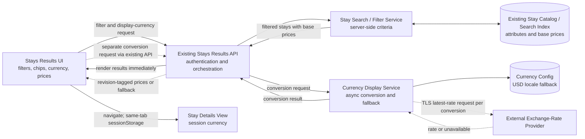

# DocSync-Bot — Architecture

## 1. Goals of this Architecture
Deliver a pluggable, testable core engine that:
1. Detects doc-impacting code changes in a diff.
2. Maps changes to documentation artifacts across multiple doc types.
3. Generates AI-assisted update suggestions via a provider-agnostic LLM client.
4. Surfaces suggestions through two front doors: a **VS Code extension** (interactive) and a **CLI** (used by a
   GitHub Action for the automated PR trigger).

The same core engine (`docsync-core`) is shared by both front doors — no logic is duplicated between the
extension and the CI-triggered path.

> **MVP boundary (per Step 3 design review):** `docsync-core`, `docsync-cli`, and the GitHub Action path are
> implemented to full depth with tests across all 4 doc adapters. The VS Code extension is an intentionally thin
> stub — one command that calls `docsync-core` in-process and renders results — rather than a full editor
> integration, to keep implementation/test effort focused on the core engine.

## 2. High-Level Component Diagram

```
                         ┌────────────────────────────────────────────┐
                         │                 Triggers                    │
                         │  ┌──────────────┐      ┌──────────────────┐│
                         │  │ GitHub Action │      │ VS Code command  ││
                         │  │ (PR open/sync)│      │ (manual, on-demand)││
                         │  └──────┬───────┘      └─────────┬────────┘│
                         └─────────┼─────────────────────────┼─────────┘
                                   │                          │
                                   ▼                          ▼
                         ┌─────────────────────────────────────────────┐
                         │              docsync-cli (bin)               │
                         │     (thin wrapper: parses args/env, calls     │
                         │        core, formats output / exit code)     │
                         └───────────────────────┬───────────────────────┘
                                                  │
                         ┌────────────────────────▼────────────────────────┐
                         │                 docsync-core                     │
                         │                                                   │
                         │  ┌───────────────┐   ┌─────────────────────────┐ │
                         │  │ DiffAnalyzer  │──▶│ LinkResolver             │ │
                         │  │ (git diff →   │   │ (code symbol ⇄ doc       │ │
                         │  │  changed      │   │  artifact mapping via    │ │
                         │  │  symbols)     │   │  docsync.config.json)    │ │
                         │  └───────────────┘   └───────────┬─────────────┘ │
                         │                                   │               │
                         │                                   ▼               │
                         │                     ┌─────────────────────────┐   │
                         │                     │ DriftDetector            │   │
                         │                     │ (semantic diff: code vs  │   │
                         │                     │  doc content)            │   │
                         │                     └───────────┬─────────────┘   │
                         │                                   │                │
                         │                                   ▼                │
                         │                     ┌─────────────────────────┐    │
                         │                     │ SuggestionEngine         │    │
                         │                     │ (prompt templates +      │    │
                         │                     │  LLMProvider interface)  │    │
                         │                     └───────────┬─────────────┘    │
                         │                                   │                 │
                         │                                   ▼                 │
                         │                     ┌─────────────────────────┐     │
                         │                     │ Validator                │     │
                         │                     │ (cross-check generated   │     │
                         │                     │  text vs. real signatures)│     │
                         │                     └───────────┬─────────────┘     │
                         │                                   │                  │
                         └───────────────────────────────────┼──────────────────┘
                                                              ▼
                         ┌─────────────────────────────────────────────────────┐
                         │                 Doc-Type Adapters (pluggable)         │
                         │  ┌───────────┐ ┌───────────┐ ┌─────────┐ ┌─────────┐ │
                         │  │ Docstring │ │ Markdown  │ │ OpenAPI │ │ Confluence│ │
                         │  │ Adapter   │ │ Adapter   │ │ Adapter │ │ Adapter   │ │
                         │  └───────────┘ └───────────┘ └─────────┘ └─────────┘ │
                         └─────────────────────────────────────────────────────┘
                                                              │
                         ┌────────────────────────────────────▼────────────────┐
                         │              Output Sinks (pluggable)                 │
                         │  ┌───────────────┐ ┌───────────────┐ ┌──────────────┐│
                         │  │ GitHub PR     │ │ VS Code Diff  │ │ Confluence   ││
                         │  │ comment/check │ │ view (webview)│ │ REST publish ││
                         │  └───────────────┘ └───────────────┘ └──────────────┘│
                         └───────────────────────────────────────────────────────┘
```

## 3. Component Responsibilities

| Component | Responsibility |
|---|---|
| **DiffAnalyzer** | Uses `simple-git` to get the changed file list for `base...head`, then reads **both** versions of each file (`git show base:path`, `git show head:path`) and parses each independently with the matching language adapter (`ts-morph` for TS/JS, regex-based signature extraction for Python) into a `SymbolModel`. Diffs the base/head `SymbolModel` lists to produce `changedSymbols` (added/removed/modified). |
| **LinkResolver** | Loads `docsync.config.json` (or built-in defaults if absent), resolves which doc artifacts are linked to each changed symbol using the per-doc-type linkage convention (§3.2). |
| **DriftDetector** | Applies the concrete drift rules (§3.1) to each changed symbol + its linked doc artifact (if any); outputs `DriftFinding[]` with a severity (`high`/`medium`/`low`). |
| **SuggestionEngine** | For each `DriftFinding`, redacts likely secrets from the code/diff snippet (`redactSecrets()`), renders a doc-type-specific prompt template, and calls `LLMProvider.generate()`. Falls back to detection-only (no generated content) if no `LLMProvider` is configured. |
| **Validator** | Static cross-check: every parameter/type named in the generated text must exist in the actual signature; strips/flags unverifiable claims before returning a suggestion. |
| **Doc-Type Adapters** | Each adapter implements a common `DocAdapter` interface: `parse(file) → DocModel`, `render(DocModel) → string`, `locate(symbol) → DocModel \| undefined`. One adapter per doc type (docstring, Markdown, OpenAPI, Confluence). |
| **Output Sinks** | Deliver the final `Suggestion[]` to the right surface: GitHub PR check + comment (CLI/Action path), VS Code Output channel + diff webview (extension path), or direct Confluence publish (opt-in, explicit accept only). |
| **LLMProvider** | Interface with two implementations: `MockLLMProvider` (deterministic, offline, used in tests) and `GitHubModelsProvider` (real calls to the GitHub Models/Copilot inference endpoint). Resolved to `undefined` (→ fallback mode) when no API key env var is set. |

### 3.1 Concrete Drift Rules (resolved in Design Review, Finding 3)

| Condition | Severity |
|---|---|
| Documented parameter names/count/order differ from code | `high` |
| Documented parameter or return type differs from code | `high` |
| New exported symbol added with no linked doc artifact | `medium` |
| Signature unchanged, but function body changed >30% of lines | `low` (flagged for review, not asserted wrong) |

### 3.2 Doc-to-Code Linkage Convention per Type (resolved in Design Review, Finding 4)

| Doc type | Linkage mechanism |
|---|---|
| Docstring | Symbol identity is structural (same file + function/class name) — no tag needed. |
| Markdown | Inline `<!-- docsync:ref <symbolId> -->` comment above the documented section. |
| OpenAPI | `x-docsync-ref: <symbolId>` vendor extension on the operation object. |
| Confluence | Explicit entries in `docsync.config.json`: `{"symbolId": "...", "confluencePageId": "..."}` (pages can't carry inline code tags). |

## 4. Technology Choices

| Concern | Choice | Rationale |
|---|---|---|
| Language/runtime | TypeScript on Node.js 20+ | Matches VS Code extension API; one language across core/CLI/extension. |
| Monorepo tooling | npm workspaces | Simple, no extra tooling needed for 3 packages. |
| Git diff parsing | `simple-git` | Mature wrapper over the `git` CLI already present in CI/dev environments. |
| TS/JS code parsing | `ts-morph` | Reliable AST access to function signatures and JSDoc blocks. |
| Markdown parsing | `remark`/`unified` | Standard, extensible Markdown AST tooling. |
| OpenAPI parsing | `@apidevtools/swagger-parser` / `yaml` | De-facto standard for OpenAPI load/validate. |
| Confluence integration | Confluence REST API v2 via `fetch` | No heavy SDK dependency; REST is stable and documented. |
| LLM transport | GitHub Models inference endpoint (OpenAI-compatible chat completion) via `fetch` | Matches the API key the user already holds; OpenAI-compatible shape keeps `LLMProvider` portable to other vendors later. |
| CLI | `commander` | Lightweight, standard Node CLI argument parsing. |
| VS Code extension | `vscode` Extension API, `docsync-core` as a dependency | Keeps UI thin; all logic lives in the testable core package. |
| Testing | `jest` + `ts-jest` | Standard TS testing stack, good mocking support for `LLMProvider`. |
| CI trigger | GitHub Actions workflow (`.github/workflows/docsync.yml`) on `pull_request` (opened/synchronize) | Matches FR-13; runs `docsync-cli check`. |

## 5. Data Flow (PR-Triggered Path)

1. GitHub Action fires on `pull_request: [opened, synchronize]`.
2. Workflow checks out the PR's merge commit (`actions/checkout` with `fetch-depth: 0`) and runs
   `npx docsync-cli check --base origin/<base> --head HEAD`.
3. `DiffAnalyzer` reads base + head versions of each changed file → `changedSymbols`. `LinkResolver` maps them to
   doc artifacts → `DriftDetector` applies the drift rules (§3.1) to emit `DriftFinding[]`.
4. For each finding, `SuggestionEngine` redacts secrets, calls the configured `LLMProvider` (or falls back to
   detection-only if none is configured) → `Validator` checks the result → emits `Suggestion[]`.
5. CLI formats `Suggestion[]` as a PR comment (Markdown table + diff blocks) and sets a check-run status
   (`neutral` if no findings or fallback mode; `success`/`failure` otherwise, per `docsync.config.json` severity
   threshold — FR-18).
6. CLI exit code reflects pass/fail for the GitHub Actions job status.

## 6. Data Flow (VS Code Manual Path)

1. User runs **"DocSync: Check Current Branch"** from the command palette.
2. Extension calls the same `docsync-core` API in-process (no CLI spawn needed) with `base = default branch`,
   `head = working tree`.
3. Results render in the Output channel and a simple webview diff panel; each suggestion has **Accept / Edit /
   Reject** actions (FR-16).
4. On **Accept**, the extension writes the change directly to the file in the editor (undo-able), leaving the
   commit to the user's normal git workflow.

## 7. Key Design Decisions
- **Single shared core, two thin front doors** — avoids divergent detection logic between CI and the editor.
- **Suggestions are never auto-applied** — both paths always produce a diff requiring explicit human acceptance
  (NFR-5).
- **LLMProvider is swappable** — `MockLLMProvider` used in all unit/integration tests so the suite is
  deterministic and runs with zero cost/network dependency; `GitHubModelsProvider` used for real/manual runs via
  an API key read from an environment variable (never committed — NFR-8), with automatic fallback to
  detection-only mode when the variable is absent (NFR-4).
- **Outbound secret redaction** — `redactSecrets()` strips common API-key/token/connection-string shapes from any
  code/diff snippet before it is included in an LLM prompt (defense-in-depth alongside path exclusion — NFR-7,
  NFR-10).
- **Confluence publish is opt-in only** — the adapter can generate a suggested page diff, but actually calling the
  Confluence write API requires an explicit `--publish` flag/UI action, never implicit.
- **Config defaults** — absence of `docsync.config.json` is not an error: the CLI/extension falls back to
  built-in defaults (whole-repo scan, all 4 adapters enabled, `medium` severity blocks merge) and logs that
  defaults are in effect.

## 8. Known Limitations (MVP)
- Python signature extraction uses regex-based parsing (not full AST) — acceptable for MVP; Java/Go are
  documented as future adapters, not implemented.
- Confluence integration is tested against a mocked HTTP layer, not a live Confluence instance.
- GitHub Models/Copilot endpoint rate limits are unknown at build time; `SuggestionEngine` includes basic
  retry/backoff but no adaptive throttling.
- VS Code extension is a thin command + webview, not a full inline-editor integration (see MVP boundary, §1).

## 9. EPMCDMETST-47868 — Stays: Advanced Filters & Currency Viewing Options

> **Product boundary:** This ticket describes a travel-booking Stays search feature, separate from
> DocSync-Bot's documentation-drift tooling above. This section documents the ticket architecture
> only; it does not extend the DocSync-Bot application architecture.

**Confluence page:** [High-level diagram for EPMCDMETST-47868](https://decentdkdeepak.atlassian.net/wiki/spaces/Epam/pages/18644993)
**Source requirements:** FR-27–FR-37; NFR-23–NFR-25.

### 9.1 Scope, Goals, and Exclusions

Extend the existing Stays search-results flow with the seven advanced-filter categories in FR-28
and display-only currency selection/conversion. Users can inspect active filters, clear advanced
filters, and carry the selected display currency from results to a stay's details page in the same
session.

The design must preserve the existing booking/payment currency; currency conversion is for display
only. Historical/offline rate support beyond the fallback behavior and non-English filter/currency
localization are excluded. Existing Stays services, inventory, and authentication are reused; no
new identity or inventory system is proposed.

### 9.2 Architecture Recommendation and Deployment Boundaries

Keep the current Stays UI and results API as the client boundary, and evaluate advanced criteria in
the existing server-side search/filter service. The UI owns filter controls, selected-filter chips,
currency selector, and formatted price presentation. Filter requests and supported-value validation
remain server-side so clients cannot disagree about result semantics.

Add a currency display service behind the results API, with an external-provider adapter and a
centrally configured supported-currency list and USD locale fallback. Resolve rates asynchronously
through a separate API request. Do not retain historical/offline rates; validate the provider
response timestamp and use original/base prices with a clear notice when the rate is unavailable,
invalid, or expired.

The main trust boundaries are the existing authenticated browser-to-Stays-API boundary, internal
API-to-search/currency-service calls, and the server-side currency-service-to-external-provider
connection. Provider calls use TLS and provider credentials remain server-side. Reuse existing
platform authentication and authorization.

### 9.3 Key Components

| Component | Responsibilities and interfaces | Owned data |
|---|---|---|
| Stays results UI | Displays basic and advanced filters, active chips, clear/reset action, currency selector, prices, and fallback notice. Sends filter/currency choices to the results API. Uses device/browser locale only when no manual choice exists and carries the session selection to stay details. | Ephemeral UI and session selection state; no provider credentials. |
| Stays results API | Existing authenticated interface for search and results; validates request values, coordinates search and currency display services, and returns filtered stays with display-currency context. | Request/response state; not the stay inventory source of truth. |
| Stay search/filter service | Applies criteria server-side. Combines distinct filter categories with AND and multiple selections within a category with OR; uses supported-value catalogs. Distance is a radius in kilometers and guest rating is a minimum. Advanced reset leaves basic-filter selections intact. | Transient query/filter state. |
| Stay catalog/search index | Existing source for stay attributes, filterable inventory, and original/base prices. | Existing stay and base-price data. |
| Currency configuration | Holds the supported ISO alpha/numeric currency list, currency display metadata, and the configured USD fallback for unsupported/ambiguous locales. | Centrally managed currency configuration; no historical rate data. |
| Currency display service | Calls the approved provider server-side over TLS, validates rate age and value, converts prices using decimal arithmetic and ISO 4217 minor-unit metadata, and returns original/base prices with a notice when conversion is unavailable. No historical/offline rate cache is introduced; only request-scoped data may be held while processing. | Transient request and conversion result only; provider credentials remain in server-side secret storage. |
| External exchange-rate provider | Approved candidate: Open Exchange Rates latest-rates API. Before integration, verify publication cadence, required currency pairs, current plan limits and terms against FR-36; use an alternate provider only after a documented design decision. | Provider response; credentials remain server-side. |
| Stay details view | Reads the display-currency selection from the same tab's `sessionStorage` on results-to-details navigation, and uses the same conversion/fallback behavior. | Per-tab session selection; booking currency remains unchanged. |

### 9.4 Technology Choices

| Concern | Recommendation | Rationale and trade-offs | Relevant alternative |
|---|---|---|---|
| Search/filter placement | Extend the existing server-side Stays search/filter service. | Reuses existing inventory and query behavior; centralizes AND/OR semantics and avoids transferring full result sets to the browser. Requires the existing search API to support the advanced criteria. | A separate filter service adds deployment and data-consistency boundaries without a stated need. |
| Exchange-rate integration | Use the approved Open Exchange Rates latest-rates API candidate through a server-side provider adapter, conditional on a due-diligence gate before integration. | Keeps credentials off the client and isolates provider-specific behavior. Verify current publication cadence, required base/target currency pairs, plan limits and terms against FR-36. If any check fails, pause integration and obtain approval for an alternative provider; do not silently substitute one. | An alternative provider requires a recorded design decision and approval before use. |
| Rate freshness and failure handling | Accept only finite, positive rates with a provider timestamp that is not in the future and is at most 5 minutes old at validation. Apply a 2-second timeout per attempt, at most one retry for transient network/429/5xx failures, and a 5-second end-to-end deadline including retry delay. On timeout, invalid/missing/expired rate, or exhausted retry, return original/base prices with a notice. Do not retain historical/offline rates. | Bounds provider work and treats stale or invalid data as unavailable, consistent with FR-37 and the historical/offline cache exclusion. Respect a provider `Retry-After` only when the retry still fits inside the total deadline; otherwise fall back. | Never silently serve stale rates or extend the deadline to complete a retry. |
| Supported currencies | Central configuration containing ISO alpha and numeric codes, display metadata, and USD as the locale fallback. | Enables extension without code changes (NFR-25), keeps UI/service lists consistent, and gives unsupported locale mappings a deterministic default. Validate currency and minor-unit metadata. | Hard-coded lists in separate components risk drift. |
| Currency formatting | Use decimal arithmetic for conversion, round to the selected ISO 4217 currency's standard minor-unit precision using the formatter's standard half-expand rule, then format for the active locale. | Avoids binary floating-point artifacts and assuming every currency uses two decimal places. This is display-only; booking/payment amounts remain unchanged. | Fixed two-decimal formatting or binary floating-point rounding can present incorrect amounts. |
| Currency selection state | Store the selected currency in per-tab `sessionStorage`; the details view reads the same tab's value. | Survives same-tab navigation and is cleared when that tab's session ends, matching FR-34 without adding cross-tab/account persistence. | Shared cross-tab or account persistence is outside the approved choice. |

### 9.5 Component Diagram



### 9.6 End-to-End Data Flow

1. On results load, the UI uses an explicit same-tab session selection if present; otherwise it
   maps the browser/device locale to a supported currency, using configured USD when the locale is
   absent, ambiguous, or unsupported (FR-35 and approved clarification). Supported options come
   from central configuration, include ISO alpha/numeric codes (FR-31), and display code-only
   labels (FR-32).
2. The traveler selects advanced filters. The UI shows each applied criterion as a chip/tag and
   sends the selection to the existing results API (FR-27, FR-29).
3. The server validates supported values and runs the filter query: AND across categories, OR among
   multiple values within one category; distance is a kilometer radius and guest rating a minimum.
   The results include original/base prices.
4. Results render immediately. The UI sends a separate conversion request to the existing results
   API. It calls the server-side currency service and returns the conversion result without exposing
   the provider to the browser (NFR-23, NFR-24). The service requests a latest rate over
   TLS, rejects non-finite/non-positive or future-dated rates, accepts only rates at most 5 minutes
   old, and applies a 2-second per-attempt timeout, at most one retry for transient network/429/5xx
   failures, and a 5-second total deadline including retry delay. A retry honors `Retry-After` only
   if it fits within the deadline. It does not read or write historical/offline rate data.
5. Each conversion request carries the active search revision, currency-selection revision, and
   requested currency; the response echoes these correlation values. The client applies a response
   only when all values still match the active search and selection, and discards obsolete responses.
   The API validates the correlation fields; cancelling obsolete work may optimize resource use but
   does not replace the stale-response check.
6. Convert with decimal arithmetic and round to the selected ISO 4217 currency's standard minor-unit
   precision using half-expand rounding before locale formatting (FR-33). For heterogeneous base
   currencies, obtain and validate a supported rate for each required base/target pair. If any
   affected price lacks a usable rate, show that price in its original/base currency with the
   explanatory notice (FR-37); never imply a fallback price is in the selected currency.
7. Navigation to stay details reads the currency from the same tab's `sessionStorage`; the
   selection lasts until the tab session ends (FR-34 clarification). The details view uses the same
   rate deadline and original/base fallback if conversion fails. Checkout and booking continue
   using their existing currency.
8. Clear/reset removes advanced selections and chips, retains basic-filter selections, and refreshes
   the results (FR-30 and approved clarification).

### 9.7 Sequence Diagram

```mermaid
sequenceDiagram
    actor Traveler
    participant UI as Stays Results UI
    participant API as Stays Results API
    participant Search as Search / Filter Service
    participant Catalog as Stay Catalog
    participant Currency as Currency Display Service
    participant Config as Currency Configuration
    participant Provider as External Rate Provider
    participant Details as Stay Details

    Traveler->>UI: Select advanced filters and display currency
    UI->>API: Search(filters, session currency)
    API->>Search: Validate and apply criteria
    Search->>Catalog: Query matching stays and base prices
    Catalog-->>Search: Matching stays
    Search-->>API: Filtered stays
    API-->>UI: Results with base prices (do not wait for rates)
    UI->>API: Separate conversion request (search revision, currency revision, currency)
    API->>Currency: Resolve display prices
    Currency->>Config: Validate supported currency and USD default
    Currency->>Provider: TLS latest-rate request (2s attempt timeout)
    alt Finite positive rate, timestamp not in future, and age at most 5 minutes
        Provider-->>Currency: Rate and provider timestamp
    else Transient error
        Currency->>Provider: One bounded retry (within 5s total deadline)
        Provider-->>Currency: Rate or error
    else Missing, malformed, expired or unavailable rate / deadline exceeded
        Provider-->>Currency: No usable rate
    end
    alt Usable rate
        Currency-->>API: Converted values and correlation values
        API-->>UI: Converted values with echoed correlation values
    else No usable rate
        Currency-->>API: Original/base prices, notice, and correlation values
        API-->>UI: Fallback with echoed correlation values
    end
    Note over UI: Apply only if search revision, currency revision, and currency still match; otherwise discard as obsolete
    Traveler->>UI: Open a stay
    UI->>Details: Navigate with session display currency
    Details-->>Traveler: Selected-currency prices or original/base prices with fallback notice
```

### 9.8 NFR Coverage and Validation

| Requirement | Architecture coverage | Validation approach |
|---|---|---|
| NFR-23 | Render results independently of asynchronous rate lookup; enforce the 2-second attempt/5-second total deadline, one transient retry, current-revision correlation, and FR-37 fallback for unavailable/invalid/expired rates. No historical/offline rate cache is retained. | Test delayed/unavailable/expired/future-dated/non-finite/non-positive rates, deadline and retry behavior, out-of-order responses, and visible fallback without delaying initial results. |
| NFR-24 | TLS for external rate calls; credentials remain server-side and are excluded from client responses and logs. | Review provider configuration and transport; test responses/logging to ensure credentials are not exposed. |
| NFR-25 | Central supported-currency configuration, not duplicated hard-coded lists. | Add a currency through configuration alone and validate selector code, numeric code, and currency formatting metadata. |
| FR-27–FR-30 | Advanced filters are additive to basic filters; chips, reset, filter matching, and approved AND/OR semantics are supported. | Test all seven filter categories, chips, AND/OR behavior, distance/rating interpretation, and reset retaining basic filters. |
| FR-31–FR-37 | Supported currency list, code-only selector, conversion, per-tab session persistence, configured USD locale fallback, external rates, revision-safe async responses, decimal/minor-unit rounding, and fallback behavior. | Test code labels, unsupported-locale USD default, manual override/session navigation, supported provider pairs, conversion/rounding across currencies with different minor units, out-of-order responses, and per-price fallback notice. |

Operations: monitor rate lookup latency, provider errors, and fallback frequency. Provider-outage
and load testing, plus staged rollout with rollback, are approved validation expectations. Define
operational thresholds and detailed test coverage with implementation/operations owners; no new SLA
is implied.

No latency or availability guarantees beyond the requirements are asserted. Rate-provider and caching
behavior must be verified with the selected provider and deployment configuration.

### 9.9 Decisions, Assumptions, Risks, and Open Questions

- **Approved defaults:** reuse current Stays/search services and supported-value catalogs; filter
  server-side with AND across categories and OR within a category; interpret distance as a kilometer
  radius and rating as a minimum; advanced reset leaves basic filters unchanged; manual currency
  selection overrides locale for the session and follows navigation to details; format with standard
  currency minor units; reuse existing authentication/authorization.
- **Approved for implementation planning (user, 2026-11-07):** Open Exchange Rates latest-rates API
  candidate, conditional on verifying publication cadence, required currency-pair coverage, plan
  limits and terms against FR-36 before integration; accept rates at most 5 minutes old; 2-second
  timeout per attempt, at most one retry for transient network/429/5xx failures, and a 5-second
  total deadline including retry delay. Do not retain historical/offline rates. If provider
  verification fails, pause integration and obtain approval for an alternative rather than silently
  changing providers.
- **Approved response contract (user, 2026-11-07):** conversion requests carry search revision,
  currency-selection revision, and requested currency; responses echo them. Apply a response only
  while all correlation values match the active search and selection; discard obsolete responses.
- **Approved rate/amount handling (user, 2026-11-07):** reject non-finite, non-positive, future-dated,
  or older-than-5-minute rates; use decimal arithmetic and ISO 4217 minor-unit precision with
  half-expand rounding for display. For heterogeneous base currencies, validate a supported rate for
  every required base/target pair. Unavailable conversions use the original/base amount and notice.
- **Risks:** provider outages/rate limits, stale rates, inconsistent base currencies among stays, and
  a locale that does not map to a supported currency. Keep results rendering independent of rates
  and preserve clear original-currency fallback. Verify provider pair coverage for every base/target
  combination before integration; if a required pair is unsupported, pause and obtain a design
  decision rather than synthesizing an unapproved conversion path.
- **Approved assumptions:** existing stay search/inventory and platform authentication remain
  authoritative; the currency choice is session-scoped and never alters booking/payment amounts.

### 9.10 Design Review Follow-up (2026-11-07)

The [ticket review](design-review.md#epmcdmetst-47868) records design risks and their disposition.
The user approved this architecture for implementation planning on 2026-11-07; this is not
production-release sign-off. Provider suitability remains an explicit pre-integration verification
gate.

- **Clarification from existing behavior:** preserving the selected currency when navigating to
  details does not guarantee a usable rate. The details view uses the same original/base-price
  fallback and explanatory notice when conversion is unavailable; the session selection is retained.
  This follows FR-34/FR-37 and the approved fallback default, rather than introducing a new policy.
- **Resolved for DR-47868-01:** request converted prices separately through the existing API; the
  provider remains server-side. Requests carry search revision, currency-selection revision, and
  requested currency; responses echo these values. Apply only responses matching the current search
  and selection; discard obsolete responses. Test out-of-order completion.
- **Resolved for DR-47868-02:** Open Exchange Rates latest-rates API candidate and the 5-minute age,
  2-second attempt timeout, one transient retry, and 5-second total deadline are approved for
  planning. Verify current cadence, required currency pairs, plan limits and terms before integration;
  if verification fails, return for a provider decision. Reject non-finite/non-positive, future-dated,
  and expired rates; use decimal conversion and ISO 4217 minor-unit precision with half-expand
  rounding. Heterogeneous base currencies require a valid rate for every needed pair. Preserve the
  approved original/base fallback and no historical/offline-cache exclusion.
- **Agreed for DR-47868-03:** use a centrally configured supported default currency when the
  device/browser locale is absent, ambiguous, or maps to an unsupported currency; USD is the
  configured value. An explicit manual session choice still takes precedence.
- **Agreed for DR-47868-04:** store the selection in per-tab `sessionStorage`, retain it for
  results-to-details navigation, and let it expire when the tab's session ends. Details reuse the
  currency resolution and fallback behavior.
- **Agreed for DR-47868-05:** monitor rate lookup latency, provider errors, and fallback frequency.
  Provider-outage/load testing and staged rollout with rollback are approved; define test coverage
  and operational thresholds with the implementation/operations owners.
- **Planning approval (user, 2026-11-07):** the ticket architecture and decisions above are approved
  for implementation planning. This is not authorization to release; implementation, provider
  due diligence, verification, operational readiness, and applicable release approvals remain.
- **Implementation gate:** verify the provider's current publication cadence, required pair coverage,
  plan limits, and terms against FR-36 before integrating. The provider has not been independently
  verified in this review. A failed check blocks provider integration and requires a documented,
  approved alternative-provider decision.
